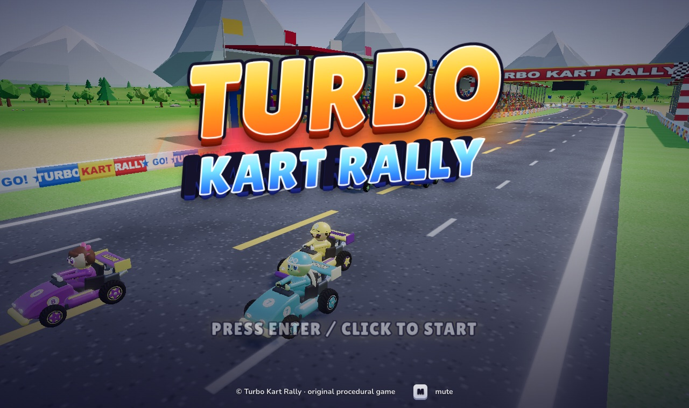

# Turbo Kart Rally

**An arcade kart racer in the spirit of Mario Kart, built entirely with Three.js. Every 3D mesh, procedural track, texture, sound effect, and music track is generated in code at runtime. There are no asset files and no build step.**

Featuring multiple game modes (Single Race, Grand Prix, Time Trial with Ghost Replay), 3 distinct procedural circuits, real-time kart customization, full mobile touch controls, and Progressive Web App (PWA) support.

<p align="center">
  <a href="https://bridge-mind.github.io/turbo-kart-rally/"></a>
</p>

<p align="center">
  <a href="https://bridge-mind.github.io/turbo-kart-rally/"><strong>▶ Play it in your browser</strong></a>
</p>

---

## 🎮 Play

Open **https://bridge-mind.github.io/turbo-kart-rally/** in any modern browser with WebGL2 (desktop, tablet, or mobile). Click or tap on the title screen, choose your racer and kart custom styling, choose your class (50cc, 100cc, or 150cc) and game mode, and hit **RACE!**.

Supports **Keyboard**, **Gamepad**, and **Mobile Touch Controls**.

---

## 🏆 Game Modes

### 1. 🏎️ Single Race
Classic quick race against 7 AI drivers on any track of your choice with configurable laps (1, 3, or 5).

### 2. 🏆 Grand Prix / Cup Mode
A complete 3-track championship across all circuits:
- **Round 1**: Palm Cove Circuit
- **Round 2**: Ember Canyon
- **Round 3**: Frosted Peaks
- **Point Scoring**: Standard championship points `(1st: 10, 2nd: 8, 3rd: 6, 4th: 4, 5th: 3, 6th: 2, 7th: 1, 8th: 0 pts)` maintained across all 8 racers.
- **Standings & Trophy Celebration**: Points scoreboard between rounds, culminating in a Championship Podium ceremony awarding **Gold**, **Silver**, or **Bronze** trophies saved to `localStorage`.

### 3. ⏱️ Time Trial + Ghost Replay
Pure hot-lap time trials with zero AI or offensive hazards:
- **3 Tactical Mushrooms**: Practice cutting corners and perfecting racing lines.
- **Holographic Ghost Car**: Telemetry is recorded at 20 Hz. When you set a personal best, a translucent cyan 3D ghost kart plays back your exact line on subsequent laps!
- **Lap Delta**: Real-time sector and lap delta indicators.
- **Quick Restart**: Instant lap restart with <kbd>R</kbd>.

---

## 🏁 Tracks

The game features 3 complete, handcrafted procedural circuits with unique themes, elevations, and obstacles:

| Track | Theme | Characteristics |
| :--- | :--- | :--- |
| 🌴 **Palm Cove Circuit** | Tropical coastal | Lagoon bridge, seaside sweepers, technical hairpin, 8 boost pads, 2 jump ramps |
| 🌋 **Ember Canyon** | Volcanic / desert | Red rock canyon, mesa switchbacks, lava lake crossing, long straights, tight chicane |
| ❄️ **Frosted Peaks** | Alpine mountain | Snow-covered summit, frozen lake crossing, ski jump ramp, pine forest high-speed sweepers |

---

## 🎨 Kart Customization

Customize your kart in the select menu with real-time 3D preview:
- **Primary Paint Finishes**: *Character Default, Crimson Fury, Cyber Cyan, Solar Yellow, Emerald Green, Sunset Orange, Royal Violet, Obsidian Black, Pearl White*.
- **Custom Wheel Rims**: *Stock Wheels, Gold Pro Spoke, Chrome Star, Cyber Neon, Shadow Carbon, Hyper Magenta*.
- All customizations persist in `localStorage` and apply across Single Race, Grand Prix, and Time Trial modes.

---

## 📱 Mobile Touch Controls & PWA

- **Neo-Arcade Touch Controls**: On-screen multi-touch buttons for steering (◀ / ▶), gas, brake/reverse, hop/drift, and item use.
- **PWA Installation**: Install directly to iOS or Android home screen with `manifest.json`, high-resolution vector icons, and landscape lock.
- **Offline Play**: Powered by a Service Worker (`sw.js`) that pre-caches all code, assets, audio, and shaders.

---

## 🕹️ Controls

| Action | Keyboard | Gamepad | Mobile Touch |
| :--- | :--- | :--- | :--- |
| **Accelerate** | <kbd>W</kbd> / <kbd>↑</kbd> | <kbd>A</kbd> / RT | Green **GAS** button |
| **Brake / Reverse** | <kbd>S</kbd> / <kbd>↓</kbd> | <kbd>B</kbd> / LT | Red **BRAKE** button |
| **Steer** | <kbd>A</kbd> <kbd>D</kbd> / <kbd>←</kbd> <kbd>→</kbd> | Left Stick / D-Pad | **◀** and **▶** buttons |
| **Hop / Drift** | <kbd>Space</kbd> | <kbd>RB</kbd> / <kbd>X</kbd> | Yellow **DRIFT** button |
| **Use Item** | <kbd>E</kbd> / <kbd>X</kbd> / <kbd>Shift</kbd> | <kbd>LB</kbd> / <kbd>Y</kbd> | Purple **ITEM** button |
| **Look Back** | <kbd>C</kbd> | Stick Click | — |
| **Quick Restart** *(Time Trial)* | <kbd>R</kbd> | — | Menu Restart |
| **Pause** | <kbd>Esc</kbd> / <kbd>P</kbd> | Start | Top **⏸** button |
| **Mute Audio** | <kbd>M</kbd> | — | — |
| **Toggle Fullscreen** | — | — | Top **⛶** button |

> **Pro Tip**: Hold drift through turns until sparks transition from blue to orange to purple, then release for a powerful Mini-Turbo boost. Hold accelerate right as the countdown reaches **GO** for a rocket start!

---

## 🚀 Run It Locally

There is no build step or bundler needed. Serve the directory with any local static server:

```bash
git clone https://github.com/bridge-mind/turbo-kart-rally.git
cd turbo-kart-rally
python3 -m http.server 8080
```

Then visit **http://localhost:8080** in your browser. Three.js r170 is loaded from jsDelivr via an import map.

---

## 📁 Project Layout

```
turbo-kart-rally/
├── index.html            Entry HTML, viewport meta, and import map
├── manifest.json         PWA web app manifest (standalone, landscape)
├── sw.js                 Service Worker for offline caching & instant launch
├── icon.svg              High-resolution vector PWA app icon
├── ARCHITECTURE.md       System specifications & module contracts
├── src/
│   ├── main.js           Renderer, post-processing, game state machine, loop
│   ├── config.js         Racers, physics constants, items, key bindings
│   ├── events.js         Shared lightweight event bus
│   ├── tracks.js         Track registry (Palm Cove, Ember Canyon, Frosted Peaks)
│   ├── track.js          Track spline, procedural road geometry, collision
│   ├── track-textures.js Procedural asphalt, curb, and terrain canvas textures
│   ├── environment.js    Sky, lighting, water, terrain, vegetation, scenery
│   ├── grandprix.js      Grand Prix cup manager, points tally, and trophies
│   ├── ghost.js          Time Trial telemetry recorder & holographic ghost car
│   ├── customization.js  Kart paint palettes, wheel rim styles, persistence
│   ├── touch.js          Responsive mobile virtual touch controls overlay
│   ├── kart.js           Arcade kart physics, drift stages, boost, collisions
│   ├── ai.js             AI driver pathing, drifting, obstacle avoidance
│   ├── input.js          Keyboard, gamepad, and virtual touch input layer
│   ├── items.js          Item boxes, roulette, and 8 projectile/buff behaviors
│   ├── effects.js        Particle systems: drift sparks, boosts, smoke, stars
│   ├── models.js         3D procedural karts, character hats, driver meshes
│   ├── camera.js         Dynamic chase camera with lead and shake
│   ├── race.js           Laps, standings, checkpoints, wrong-way detection
│   ├── hud.js            In-game HUD, minimap, speedometer, and results screens
│   ├── menu.js           Title, character select, customizer, pause menu
│   ├── audio.js          Synthesized Web Audio sound effects & sequenced chiptune
│   └── styles.css        Glassmorphic arcade UI styling & responsive layout
└── dev/                  Per-module test harnesses
```

Open `window.__game` in your browser console for debugging hooks:
- `__game.startRace({ mode: 'grandprix' })`
- `__game.toFinalLap()`
- `__game.finishPlayer()`
- `__game.debug.autopilot = true`

---

## ⚖️ Disclaimer

Turbo Kart Rally is an original, fan-made homage to the kart-racing genre. It is not affiliated with, endorsed by, or associated with Nintendo. All characters, circuits, names, art, music, and code in this repository are original.

## 📄 License

[MIT](LICENSE) © 2026 BridgeMind
